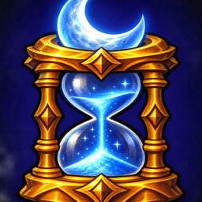
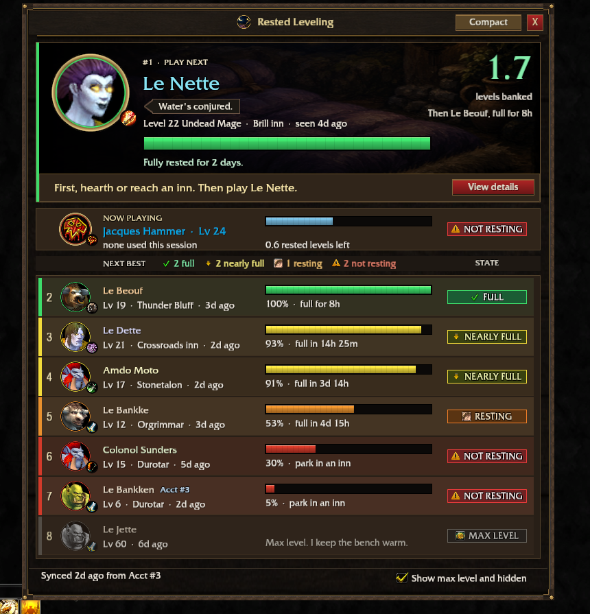
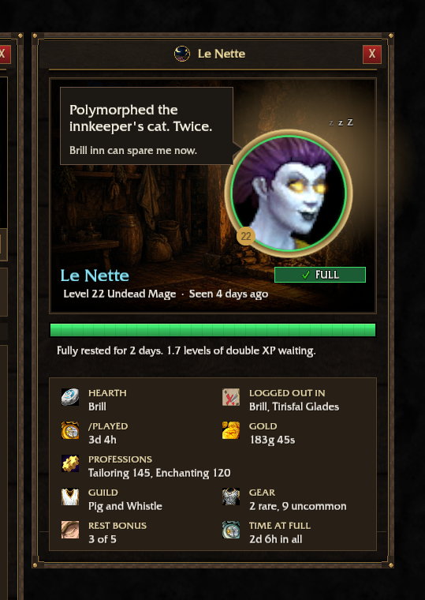
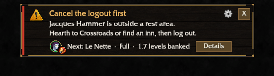
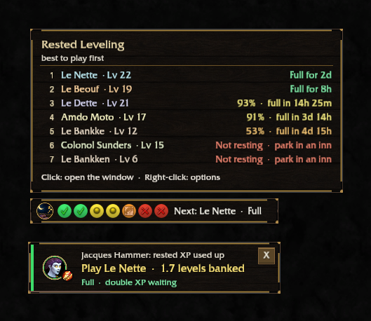
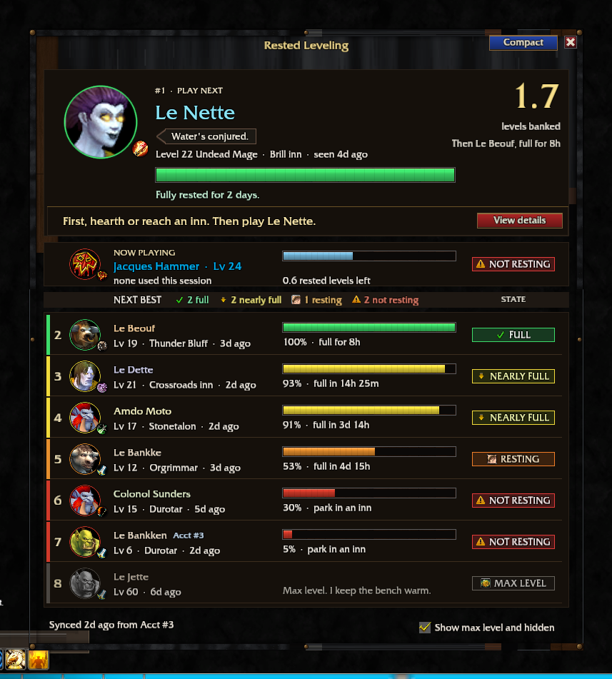

# Rested Leveling

**Never level unrested.** A WoW Forever addon that shows every character's rested XP at a glance, sorts your roster
so the top character is the one to play next, and warns you (no popups) before you log out somewhere you aren't
resting.

## What it does

- **PLAY NEXT.** The character at the top is the one to log in next, with the reason in plain words
  ("Full for 2d. 1.7 levels of double XP waiting."). Then the rest, best first: full (longest full on top), nearly
  full, most double XP banked, empty, then max level and hidden characters, dimmed.
- **Colours with words.** Green full, yellow 90%+, orange resting, red logged out outside ("park me": log in,
  hearth, log out, it fills 4x faster). Every state also has an icon and a word, so colour is never the only cue.
- **The character you're on** gets its own strip: rested XP left, roughly how many double-XP kills that is, and how
  much rest this session has used.
- **Character cards.** Click anyone: they step onto a stage (an inn at night, or a cold road if you left them
  outside) and tell you how they're doing, with their tidbits: /played, hearth, gold, professions, guild, gear, where
  they logged out and Well Rested rank.

  

- **Alerts, never popups.** Logging out outside an inn or city: a banner, a sound and a chat line ("move to cancel").
  A strip under the Esc menu while you're not resting. "Out of rested, next up: Le Nette (full)." Alts filling up,
  a login digest, sleeping bag ready. Click to dismiss, right-click to turn that kind off (`/rlvl alerts`).

  

- **Compact mode** (one line of state pips) and a **LibDataBroker feed** ("2 full | 3 resting | 2 outside", the
  tooltip is the mini roster), which ElvUI shows as a datatext. A minimap button with the app icon (left-click: the
  window, right-click: settings; hide it in the settings or with `/rlvl minimap`).

  

- **Title bar.** The cog by the window's close button opens the settings (right-click it to unlock the notifications
  and drag them where you want them); the chevron beside it switches to compact mode.

- **ElvUI.** With ElvUI loaded, the windows go through ElvUI's own skin functions, fonts and bar texture, so ElvUI
  skins such as ElvUI_WC3 apply to them too. Options also appear in `/ec`. Style can be forced: auto, default, elvui.

  

## Both of your WoW accounts

Saved variables are per WoW account, so each account only knows its own characters. Rested Leveling swaps rosters
between your own clients with hidden addon messages while both are online, once you pair them: type
`/rlvl link <Name>` on each account, naming a character on the other one. Pairing is mutual and remembered; nothing
is sent to, or accepted from, a name that has not linked you back. Each side sends its own characters, the newest
snapshot of each wins, and a remote copy never overwrites one of your own characters.

Limits (the game's, not the addon's):

- Both characters must be on the **same realm and the same faction** (the game blocks cross-faction addon whispers).
- The two accounts must be online together at least once. Characters from the other account are shown as projections
  from the last sync, tagged "synced".
- No desktop companion, no Battle.net messages, nothing outside the game. Received data is only parsed against a fixed
  schema and never executed.

## Commands

`/rlvl` (or `/restedleveling`) opens the window. `/rlvl help` lists the rest: `list`, `target <level|off>`,
`hide|show <name>`, `account <label>`, `link <Name>`, `sync`, `alerts [kind]`, `options`, `move`, `minimap`,
`ranks <0-5>`.

## How the numbers work

Rest builds 5% of a level per 8 hours in an inn or a city (a quarter of that outside one), up to 1.5 levels, both
raised 4% per rank of the Well Rested Legacy perk (read from the Legacy tree). Only the character you're on can be
read, so everyone else is projected from their last snapshot, and each login compares the projection with the real
value and corrects the rate or cap. The 30 bubbles on each bar are 5% of a level each: one bubble per 8 hours resting.

## Development

- `lua5.1 tests/run.lua` runs the tests against a fake client that only offers names the real client has.
- `luacheck .` (the `.luacheckrc` is generated, like `docs/API.md`, by `python3 tools/apicheck.py`, which checks every
  game name the addon uses against Blizzard's own UI source for Forever and classic_era).
- `tools/render.sh <outdir>` renders the windows in [wow-ui-sim](https://github.com/Osso/wow-ui-sim) from the real
  addon code; `python3 tools/readme_shots.py <outdir>` crops the screenshots above.
- `python3 media/src/gen_media.py` rebuilds the textures from `media/src/`.

## Credit

Rested Leveling builds on [Rested Watch](https://gitlab.com/docbiddle/RestedWatch) by doc_biddle (GPL-3.0): its
rested-XP projection, self-calibration, Well Rested rank reader and sleeping-bag logic, and the test harness idea.
Thank you.

The app icon was generated for this addon.

Embedded libraries: LibStub, CallbackHandler-1.0, LibDataBroker-1.1 and LibDBIcon-1.0, each under its own licence.

## Licence

GPL-3.0. See `LICENSE`.

Cooked up by Andy Doucet. Coded by Marcus.
